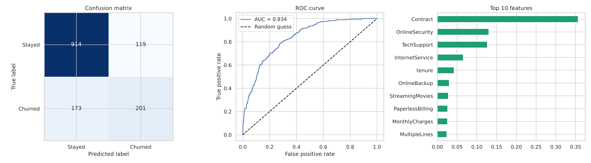
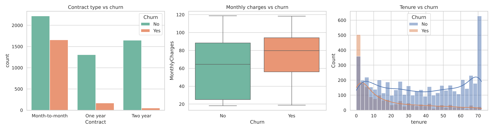

# 📡 Telecom Customer Churn Prediction

An end-to-end machine learning project that predicts whether a telecom customer will leave, and uses **Google Gemini** to turn the prediction into a plain-English retention report. Built with Python, scikit-learn, XGBoost and Streamlit.

🔗 **Live demo:**https://churn-predictor15.streamlit.app

## Problem
Acquiring a new customer costs far more than keeping an existing one. If a telecom company can spot customers likely to leave, it can act (discounts, contract offers, support) before they go.

## Dataset
[IBM Telco Customer Churn](https://github.com/IBM/telco-customer-churn-on-icp4d) — 7,043 customers, 21 columns (demographics, services, contract, billing). About **26.5%** of customers churn, so the classes are imbalanced.

## Approach
1. **EDA** – churn rates by contract, tenure and charges
2. **Preprocessing** – fixed blank `TotalCharges` values (11 rows dropped), label-encoded categorical columns, stratified 80/20 train/test split
3. **Modelling** – compared Logistic Regression, Random Forest and XGBoost
4. **Evaluation** – accuracy, precision, recall, F1, ROC-AUC, confusion matrix
5. **App** – Streamlit UI → XGBoost churn probability → Gemini writes a 3-part retention report

## Results (held-out test set, 1,407 customers)

| Model | Accuracy | Precision | Recall | F1 | ROC-AUC |
|---|---|---|---|---|---|
| Logistic Regression | 0.796 | 0.628 | 0.570 | 0.597 | 0.835 |
| Random Forest | 0.793 | 0.647 | 0.489 | 0.557 | 0.834 |
| XGBoost | 0.792 | 0.628 | 0.537 | 0.579 | 0.834 |

All three models perform very similarly (~79–80% accuracy, ROC-AUC ≈ 0.83). XGBoost is used in the app. Because only ~1 in 4 customers churn, recall and ROC-AUC are more informative than accuracy.



## Key insights
- **Contract type is the strongest driver.** Churn rate: month-to-month **42.7%**, one-year **11.3%**, two-year **2.8%**.
- Customers without **online security** or **tech support** churn more.
- Churn falls sharply as **tenure** grows — the first months are the riskiest.



## Project structure
```
├── churn_prediction.ipynb     # full pipeline: EDA → training → evaluation → saves model
├── app.py                     # Streamlit app (XGBoost + Gemini)
├── churn_model.json           # trained XGBoost model
├── columns.json               # feature order used in training
├── encoders.json              # category → number mappings
├── model_results.csv          # model comparison table
├── requirements.txt
├── assets/                    # charts used in this README
└── .streamlit/secrets.toml.example
```

## Run it yourself

**1. Train (optional – trained files are already included).** Open `churn_prediction.ipynb` in Google Colab and choose *Runtime → Run all*.

**2. Run the app locally**
```bash
git clone https://github.com/<your-username>/churn-prediction.git
cd churn-prediction
pip install -r requirements.txt
streamlit run app.py
```

**3. Enable the AI report (optional).** Get a free key at [Google AI Studio](https://aistudio.google.com), then create `.streamlit/secrets.toml`:
```toml
GEMINI_API_KEY = "your-key"
```
Without a key the app still predicts churn; only the AI report is disabled. Never commit your key — `secrets.toml` is git-ignored.

## Limitations
- Trained on a single public dataset; real-world performance would need validation on a company's own data.
- `TotalCharges` in the app is approximated as `tenure × monthly charges`.
- The LLM report is generated text based on the customer profile and model score — it is guidance, not a verified explanation of the model's internals.

## Tech stack
Python · pandas · NumPy · scikit-learn · XGBoost · Matplotlib · Seaborn · Streamlit · Google Gemini API (`google-genai`)

## License
MIT
